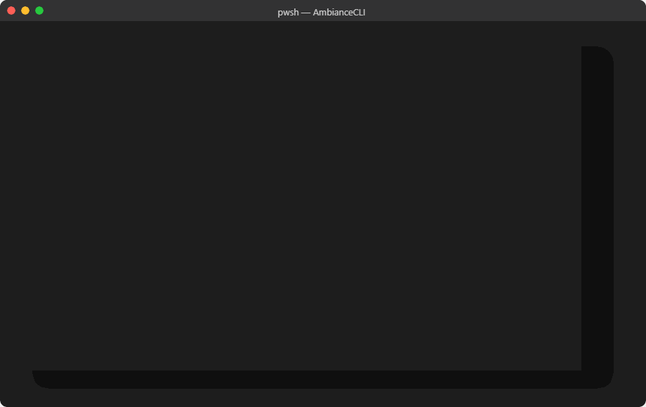
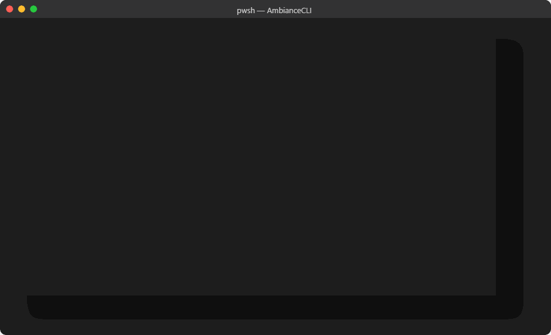
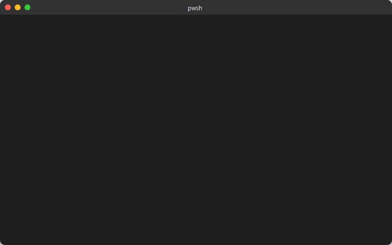
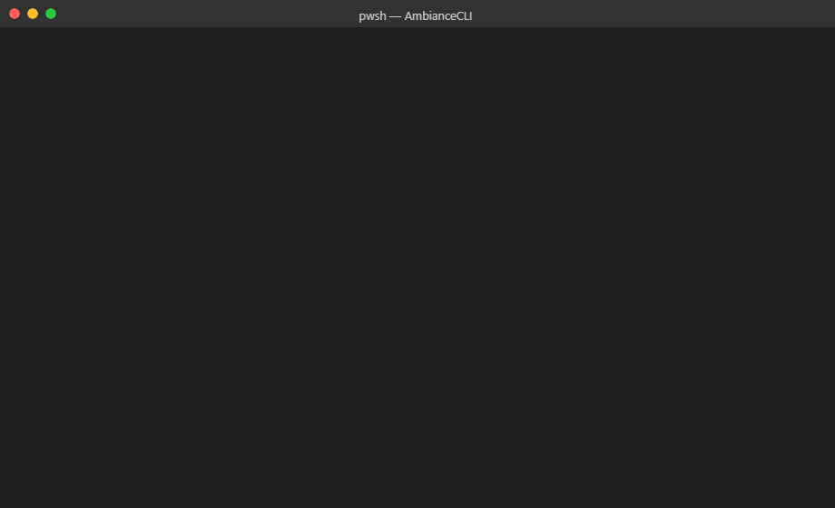

# Ambiance CLI

CLI-first Agent Accessible local code context and analysis for agent workflows.  Uses AST-grep for semantic code search and analysis with compacting for token efficiency. AmbianceCLI fetches appropriate context from accross the project, your agent decides where to dig deeper. Meaning faster, more efficient, code completion. 


### `ambiance context` — Semantic code search
Instead of grepping through hundreds of files, ask a natural language question and get ranked results with jump targets, key symbols, and config — in milliseconds.



## 0.6.0 update

- Reduce local embedding work by deduplicating cold inputs and reusing unchanged vectors.
- Keep indexes current across file additions, renames and deletions; recover interrupted writes and report inference failures.
- Fix project-relative imports and summary paths, plus watcher retries and shutdown cleanup.

The candidate passes 34 installed-package lifecycle checks locally. See the [acceptance report](docs/release-acceptance-2026-11-13.md) for results and pending CI validation.

## Install

Requires Node.js 22 or newer. Use the latest patched Node.js 22 or 24 LTS release.

```bash
npm install -g @jackjackstudios/ambiance-cli
```

### Install Agent Skill
To integrate Ambiance directly into your favorite AI environments, install the Ambiance Agent Skill:
```bash
ambiance skill install
```
By default, this will copy the skill definitions into the known configuration directories of `.claude`, `.gemini`, `.antigravity`, `.codex`, and `.cursor`.

## Quick Start

```bash
ambiance --help
ambiance doctor --json
ambiance skill verify --json
```

## More Demos

### `ambiance handoff` — Portable agent continuity
Discover locally retained Codex and Claude sessions by numbered provider title, or search normalized
conversation text with local BM25 ranking. Then create a compact, evidence-linked handoff that
reconciles the selected conversation with the repository's current state.

```bash
ambiance handoff list --all-projects --limit 10
ambiance handoff search "Temporal cancellation" --all-projects --limit 10
ambiance handoff create 2 --compact
ambiance handoff create --session-id <session-id> --compact --all-projects
ambiance handoff evidence <handoff-id> --tests --json
```

Handoffs are stored outside the repository under `~/.ambiance/handoffs` by default. Source
transcripts are read-only and are copied only when `--include-transcript` is explicitly supplied.
Search uses a redacted, reasoning-free incremental FTS cache under `~/.ambiance/cache`.
Handoff creation does not create, refresh, or query the project embedding index. If the result warns
that symbol-level code evidence was unavailable, use its referenced files and exact identifiers in
one bounded `ambiance context --no-embeddings --format index` query.

### `ambiance hints` — Instant project orientation
One command gives any agent or developer a full orientation to an unfamiliar codebase: architecture patterns, key folders, entry points, and top functions.



### `ambiance summary` — File complexity at a glance
Instantly surfaces cyclomatic complexity, symbol counts, and architectural patterns so you know which files need attention.


### `ambiance grep` — AST-aware pattern matching
Finds exact function invocations, not comments or string matches. Compared here against standard text grep on the same codebase.



### `ambiance debug` — Log-to-code tracing
Paste a log line and get back the relevant source locations, stack context, and suggested fix targets.



## CLI Commands

All commands support JSON mode via `--json`.

- `ambiance context "<query>" --json --project-path <path>`
- `ambiance hints --json --project-path <path>`
- `ambiance summary <file> --json`
- `ambiance manifest --json --project-path <path>` - **NEW**: Project-wide function listing
- `ambiance debug "<log text>" --json --project-path <path>`
- `ambiance grep "<ast pattern>" --json --project-path <path>`
- `ambiance frontend --json --project-path <path>`
- `ambiance embeddings <action> --json --project-path <path>`
- `ambiance packs <create|list|get|delete|template|ui> --json`
- `ambiance handoff [list|search|create|show|evidence] --json`
- `ambiance compare --prompt "<prompt>" --json`

## Agent Skill Workflows

Ambiance ships versioned skill templates in `skills/ambiance`.

- Validate templates: `ambiance skill verify --json`
- Workflow docs and examples: `skills/ambiance/README.md`
- Workflow files: `skills/ambiance/workflows/*.json`

## Migration from MCP

MCP remains available as a compatibility path, but CLI is now the primary interface.

- Bridge command: `ambiance migrate mcp-map --json`

## Notes for Automation

- Prefer `--json` for machine parsing.
- Non-zero exit codes are returned for usage/runtime failures.
- Use explicit `--project-path` for deterministic runs.

Local embedding refreshes reuse unchanged inference inputs and group batches by length.
See [local embedding refresh](docs/local-embedding-efficiency.md) for cache compatibility and rebuild limits.

## Development

```bash
npm run build
npm run verify:skills
npm test
```

## License

MIT. See `LICENSE`.
