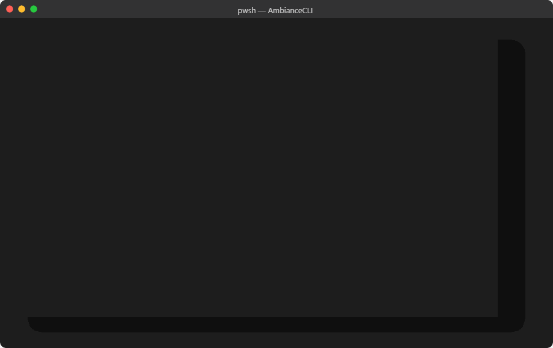
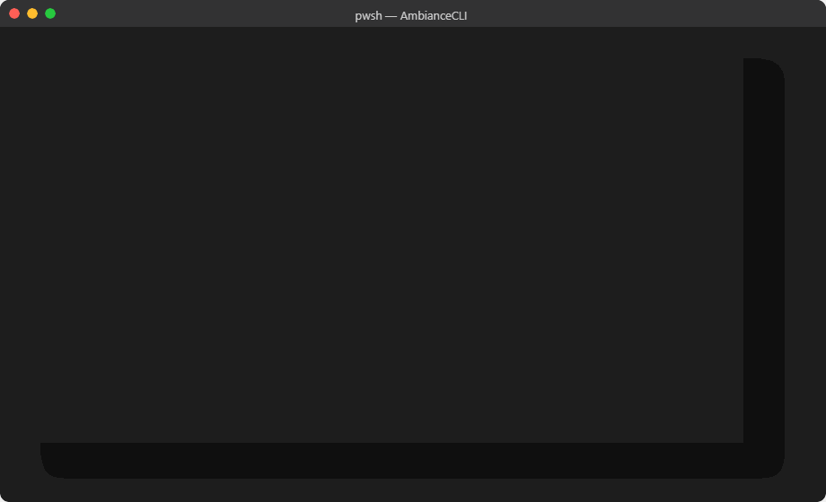
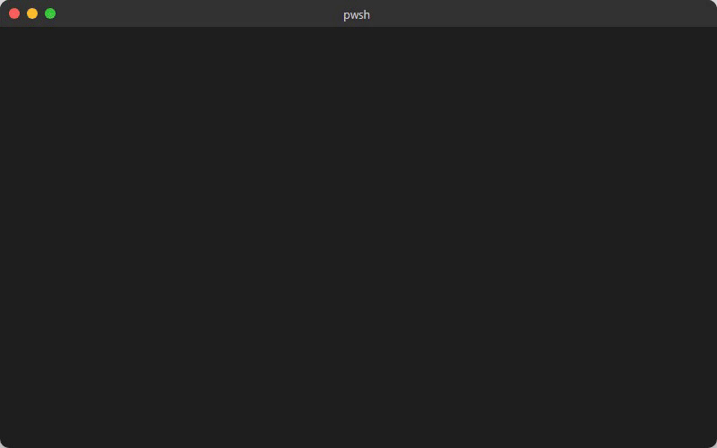
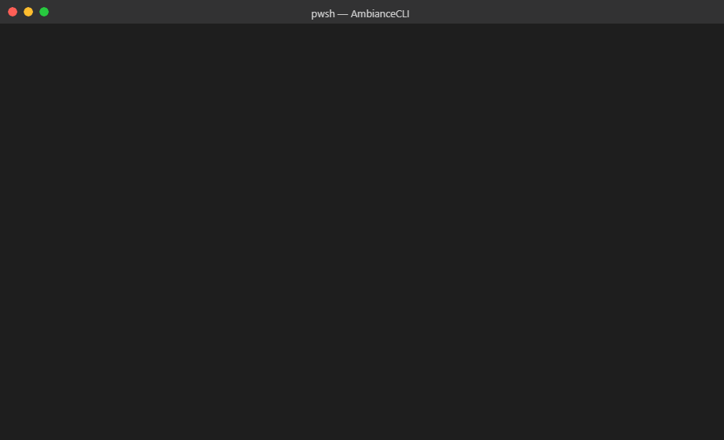

# Ambiance CLI

CLI-first code evidence for agent workflows. Build context incrementally with agent-selected search, source reads, and relationship expansion; use semantic discovery when the implementation vocabulary is unknown.

### `ambiance context` — Semantic code search

Ask a code question and get ranked source locations, key symbols, and configuration evidence.



## 0.7.0 release candidate

The prepared `0.7.0-rc.1` adds multi-term discovery, batched searches and reads,
reusable source references, explicit empty-result recovery, and numbered source
delivery to AI advisers and their callers. Lexical discovery is the default;
hybrid discovery uses an existing ready local index and reports fallback.
See the [candidate notes](docs/discovery-release-candidate.md) for validation
status and release order. Publish candidates under `rc`, and reserve `latest`
for stable releases.

## Earlier 0.6.0 update

- Reduce local embedding work by deduplicating cold inputs and reusing unchanged vectors.
- Keep indexes current across file additions, renames and deletions; recover interrupted writes and report inference failures.
- Fix project-relative imports and summary paths, plus watcher retries and shutdown cleanup.

The earlier 0.6.0 candidate passed 34 installed-package lifecycle checks locally.
Its [acceptance report](docs/release-acceptance-2026-11-13.md) is historical and
does not establish validation of the current candidate.

## Install

Requires Node.js 22 or newer. Use a patched Node.js 22 or 24 LTS release. After the candidate is published, install the pinned version below. For the stable release, omit the version suffix.

```bash
npm install -g @jackjackstudios/ambiance-cli@0.7.0-rc.1
```

### Install Agent Skill

To integrate Ambiance directly into your favorite AI environments, install the Ambiance Agent Skill:

```bash
ambiance skill install
```

By default, this will copy the skill definitions into the known configuration directories of `.claude`, `.gemini`, `.antigravity`, `.codex`, and `.cursor`.

## Quick Start

```bash
ambiance --help
ambiance doctor --json
ambiance skill verify --json
```

## More Demos

### `ambiance explore` — Agent-directed context

```bash
ambiance explore discover "cancel upload retry" --scope src --json --project-path <root>
ambiance explore read --ref '<returned ref>' --json --project-path <root>
ambiance explore follow --ref '<returned ref>' --relation dependencies --json --project-path <root>
ambiance explore search "<literal identifier>" --scope src --json --project-path <root>
```

The agent chooses each hop. Use `discover` for issue wording and `search` for an
exact string. If literal search returns no matches, reuse the words with
discovery and inspect its outcome and recovery suggestions. Read a relevant
target, refine using symbols observed in its source, and verify the caller's
imports before following another relationship. A result can be sufficient
after one call; continue only for named evidence gaps.

Batch independent discovery with `--queries '["upload retry","abortUpload"]'`
and selected reads with `--selections '[{"ref":"<first ref>"},{"ref":"<second ref>"}]'`.
Inspect each outcome for empty, delivered, deferred, or rejected evidence.
Sessions and target IDs remain supported alongside reusable refs. Changed source
invalidates old references. Static links are candidates, not proven execution
paths. Lexical discovery, literal search, reads, and following require no model
calls. Opt-in `--mode hybrid` uses a ready local embedding index and reports its
effective mode and index status. `maxTokens` bounds the shared JSON evidence;
MCP exposes the same API as `local_explore` and adds transport allowance.

### `ambiance handoff` — Portable agent continuity

Discover locally retained Codex and Claude sessions by numbered provider title, or search normalized
conversation text with local BM25 ranking. Then create a compact, evidence-linked handoff that
reconciles the selected conversation with the repository's current state.

```bash
ambiance handoff list --all-projects --limit 10
ambiance handoff search "Temporal cancellation" --all-projects --limit 10
ambiance handoff create 2 --compact
ambiance handoff create --session-id <session-id> --compact --all-projects
ambiance handoff evidence <handoff-id> --tests --json
```

Handoffs are stored outside the repository under `~/.ambiance/handoffs` by default. Source
transcripts are read-only and are copied only when `--include-transcript` is explicitly supplied.
Search uses a redacted, reasoning-free incremental FTS cache under `~/.ambiance/cache`.
Handoff creation does not create, refresh, or query the project embedding index. If the result warns
that symbol-level code evidence was unavailable, use its referenced files and exact identifiers in
one bounded `ambiance context --no-embeddings --format index` query.

### `ambiance hints` — Instant project orientation

One command gives any agent or developer a full orientation to an unfamiliar codebase: architecture patterns, key folders, entry points, and top functions.



### `ambiance summary` — File complexity at a glance

Instantly surfaces cyclomatic complexity, symbol counts, and architectural patterns so you know which files need attention.


### `ambiance grep` — AST-aware pattern matching

Finds exact function invocations, not comments or string matches. Compared here against standard text grep on the same codebase.



### `ambiance debug` — Log-to-code tracing

Paste a log line and get back the relevant source locations, stack context, and suggested fix targets.



## CLI Commands

All commands support JSON mode via `--json`.

- `ambiance context "<query>" --json --project-path <path>`
- `ambiance hints --json --project-path <path>`
- `ambiance summary <file> --json`
- `ambiance manifest --json --project-path <path>` - **NEW**: Project-wide function listing
- `ambiance debug "<log text>" --json --project-path <path>`
- `ambiance grep "<ast pattern>" --json --project-path <path>`
- `ambiance frontend --json --project-path <path>`
- `ambiance embeddings <action> --json --project-path <path>`
- `ambiance packs <create|list|get|delete|template|ui> --json`
- `ambiance handoff [list|search|create|show|evidence] --json`
- `ambiance compare --prompt "<prompt>" --json`

## Agent Skill Workflows

Ambiance ships versioned skill templates in `skills/ambiance`.

- Validate templates: `ambiance skill verify --json`
- Workflow docs and examples: `skills/ambiance/README.md`
- Workflow files: `skills/ambiance/workflows/*.json`

## Migration from MCP

MCP remains available as a compatibility path, but CLI is now the primary interface.

- Bridge command: `ambiance migrate mcp-map --json`

MCP 0.4.0-rc.1 uses this package's supported `@jackjackstudios/ambiance-cli/runtime` export.
Retrieval and index improvements belong here; MCP owns protocol schemas and response limits.
See the [paired MCP evaluation](docs/mcp-interface-evaluation-2026-11-15.md) for
retrieval parity, local embedding maintenance, and the bounded interface-choice pilot.

```js
const { executeRuntime } = require('@jackjackstudios/ambiance-cli/runtime');
const context = await executeRuntime('context', {
  projectPath: '/absolute/project',
  query: 'resolveSessionSelection',
  format: 'index',
  maxTokens: 1200,
  useEmbeddings: false,
});
```

Importing this export does not start the CLI, register signal handlers, probe providers,
or load embedding models. Operations load their implementation on demand. Pass
`{ signal: abortController.signal }` as the third argument to stop waiting for a request;
work already running may finish. The API does not change the process working directory
or environment per request. Context requests coalesce only when every input matches.

## Notes for Automation

- Prefer `--json` for machine parsing.
- Non-zero exit codes are returned for usage/runtime failures.
- Use explicit `--project-path` for deterministic runs.

Local embedding refreshes reuse unchanged inference inputs and group batches by length.
See [local embedding refresh](docs/local-embedding-efficiency.md) for cache compatibility and rebuild limits.

## Development

```bash
npm run build
npm run verify:skills
npm test
```

## License

MIT. See `LICENSE`.
